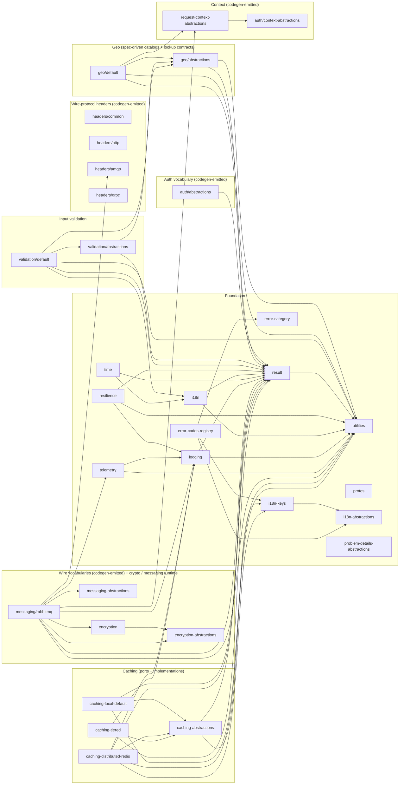

<!--
Copyright (c) DCSV. Licensed under the Apache License, Version 2.0.
-->

# packages/typescript/ - Shared TypeScript Libraries

> Parent: [`packages/`](../README.md)

Shared TypeScript libraries for Node and browser consumers. Most catalogs are emitted by code generation from the same
`contracts/` specs that drive the .NET shared libraries, so .NET and TypeScript cannot drift apart.

Each package has its own `README.md` with its public API, codegen workflow and dependencies. Generated files (`*.g.ts`)
are committed to git; each package refreshes them through its `prebuild` hook when the generator is available.

## Clusters

Some packages are grouped by concern area, and each group has an index README. The index lists and briefly describes the
packages of the group.

- [`auth/`](auth/README.md) - codegen-emitted scope / error-code / claim catalogs and the domain-safe auth-context interface
- [`geo/`](geo/README.md) - spec-driven geographic reference data and lookup contracts
- [`headers/`](headers/README.md) - per-transport wire-protocol header constant catalogs
- [`caching/`](caching/README.md) - twin of `DcsvIo.D2.Caching.*`: abstractions, local-default, distributed-redis and
  tiered, all **Built**; the shared backplane channel is `d2:cache:invalidations`

## Packages

| Package                                                                   | Status    | Purpose                                                                                                                                                                                                                                                                                                                                                                                                                                                                                                                                                                                                                                                                                                                                                                                                                                                                                                                                                                                                                                                                     | .NET mirror                                                                                                  |
| ------------------------------------------------------------------------- | --------- | --------------------------------------------------------------------------------------------------------------------------------------------------------------------------------------------------------------------------------------------------------------------------------------------------------------------------------------------------------------------------------------------------------------------------------------------------------------------------------------------------------------------------------------------------------------------------------------------------------------------------------------------------------------------------------------------------------------------------------------------------------------------------------------------------------------------------------------------------------------------------------------------------------------------------------------------------------------------------------------------------------------------------------------------------------------------------- | ------------------------------------------------------------------------------------------------------------ |
| [`result/`](result/README.md)                                             | **Built** | `D2Result<T>` shape: errors as values, semantic factories and the partial-success ladder.                                                                                                                                                                                                                                                                                                                                                                                                                                                                                                                                                                                                                                                                                                                                                                                                                                                                                                                                                                                   | `DcsvIo.D2.Result`                                                                                           |
| [`utilities/`](utilities/README.md)                                       | **Built** | `falsey()` / `truthy()` / `tryParseTruthyUndefUuid()` / `cleanStr()` and friends.                                                                                                                                                                                                                                                                                                                                                                                                                                                                                                                                                                                                                                                                                                                                                                                                                                                                                                                                                                                           | `DcsvIo.D2.Utilities`                                                                                        |
| [`resilience/`](resilience/README.md)                                     | **Built** | Retry, circuit breaker, single-flight wrappers (Polly-equivalent).                                                                                                                                                                                                                                                                                                                                                                                                                                                                                                                                                                                                                                                                                                                                                                                                                                                                                                                                                                                                          | `DcsvIo.D2.Resilience`                                                                                       |
| [`i18n/`](i18n/README.md)                                                 | **Built** | Paraglide-2.x consumer surface; reads `contracts/messages/{locale}.json`.                                                                                                                                                                                                                                                                                                                                                                                                                                                                                                                                                                                                                                                                                                                                                                                                                                                                                                                                                                                                   | `DcsvIo.D2.I18n`                                                                                             |
| [`logging/`](logging/README.md)                                           | **Built** | Pino + `ILogger` interface mirroring the .NET shape.                                                                                                                                                                                                                                                                                                                                                                                                                                                                                                                                                                                                                                                                                                                                                                                                                                                                                                                                                                                                                        | `DcsvIo.D2.Logging`                                                                                          |
| [`telemetry/`](telemetry/README.md)                                       | **Built** | OTLP-over-HTTP setup helper.                                                                                                                                                                                                                                                                                                                                                                                                                                                                                                                                                                                                                                                                                                                                                                                                                                                                                                                                                                                                                                                | `DcsvIo.D2.Telemetry`                                                                                        |
| [`time/`](time/README.md)                                                 | **Built** | Wrapper over the Temporal API. It provides the `IClock` injection seam, `SystemClock` (production) and `TestClock` (injectable in tests), and the temporal storage classes of Category 1 (`ZonedInstant`) and Category 3 (`LocalAnchoredEvent`). Their smart-constructor factories (`ZonedInstant.create()` / `LocalAnchoredEvent.create()`) return `D2Result<T>`. They validate IANA time zone names with `Intl.DateTimeFormat` and normalize them to canonical names through a `sr_ianaAliasOverrides` map, which bridges the differences between Node Intl and the .NET NodaTime `CanonicalIdMap`. `LocalAnchoredEvent.computeNextFire()` uses Temporal's `disambiguation: "compatible"`, which matches the .NET NodaTime `LenientResolver`: skipped local times map forward, and ambiguous local times pick the earlier instant. Runtimes without native `Temporal` use `temporal-polyfill@0.3.2`. This is a foundation package with no DI wiring; consumers import it directly. `contracts/temporal/temporal-adversarial.fixture.json` verifies cross-language parity. | `DcsvIo.D2.Time`                                                                                             |
| [`protos/`](protos/README.md)                                             | **Built** | Buf + `ts-proto` generated types and gRPC stubs from `contracts/protos/`.                                                                                                                                                                                                                                                                                                                                                                                                                                                                                                                                                                                                                                                                                                                                                                                                                                                                                                                                                                                                   | `DcsvIo.D2.Result.Grpc` (compiles `d2_result.proto` only)                                                    |
| [`auth/context-abstractions/`](auth/context-abstractions/README.md)       | **Built** | `IAuthContext` interface (codegen from `contracts/auth-context/IAuthContext.spec.json`).                                                                                                                                                                                                                                                                                                                                                                                                                                                                                                                                                                                                                                                                                                                                                                                                                                                                                                                                                                                    | `DcsvIo.D2.AuthContext.Abstractions`                                                                         |
| [`request-context-abstractions/`](request-context-abstractions/README.md) | **Built** | `IRequestContext` (extends `IAuthContext`) + 1:1 `PropagatedContextSerializer` class (codegen from the request-context spec).                                                                                                                                                                                                                                                                                                                                                                                                                                                                                                                                                                                                                                                                                                                                                                                                                                                                                                                                               | `DcsvIo.D2.Context.Abstractions`                                                                             |
| [`auth/abstractions/`](auth/abstractions/README.md)                       | **Built** | Codegen-emitted `Scopes` / `AuthErrorCodes` / `AuthFailures` / `JwtClaimTypes` catalogs.                                                                                                                                                                                                                                                                                                                                                                                                                                                                                                                                                                                                                                                                                                                                                                                                                                                                                                                                                                                    | `DcsvIo.D2.Auth.Abstractions`                                                                                |
| [`headers/common/`](headers/common/README.md)                             | **Built** | Cross-transport wire-protocol headers (`PROPAGATED_CONTEXT`, `TRACEPARENT`, `TRACESTATE`, `AUTHORIZATION`). Codegen from `contracts/headers/headers.spec.json`.                                                                                                                                                                                                                                                                                                                                                                                                                                                                                                                                                                                                                                                                                                                                                                                                                                                                                                             | `DcsvIo.D2.Headers.Common`                                                                                   |
| [`headers/http/`](headers/http/README.md)                                 | **Built** | HTTP-applicable wire-protocol headers (HTTP-only entries + cross-transport entries inline). Codegen from the headers spec.                                                                                                                                                                                                                                                                                                                                                                                                                                                                                                                                                                                                                                                                                                                                                                                                                                                                                                                                                  | `DcsvIo.D2.Headers.Http`                                                                                     |
| [`headers/amqp/`](headers/amqp/README.md)                                 | **Built** | AMQP-applicable wire-protocol headers (AMQP-only entries + cross-transport entries inline). Codegen from the headers spec.                                                                                                                                                                                                                                                                                                                                                                                                                                                                                                                                                                                                                                                                                                                                                                                                                                                                                                                                                  | `DcsvIo.D2.Headers.Amqp`                                                                                     |
| [`headers/grpc/`](headers/grpc/README.md)                                 | **Built** | gRPC-applicable wire-protocol headers. Codegen from the headers spec.                                                                                                                                                                                                                                                                                                                                                                                                                                                                                                                                                                                                                                                                                                                                                                                                                                                                                                                                                                                                       | `DcsvIo.D2.Headers.Grpc`                                                                                     |
| [`error-category/`](error-category/README.md)                             | **Built** | Foundational package with no dependencies: the closed `ErrorCategory` string union, the `ErrorCategoryWire` const map and the `ALL_ERROR_CATEGORIES` array. `@dcsv-io/d2-result` and `@dcsv-io/d2-error-codes-registry` import it, so those packages share byte-equal category identifiers without circular dependencies.                                                                                                                                                                                                                                                                                                                                                                                                                                                                                                                                                                                                                                                                                                                                                   | `DcsvIo.D2.ErrorCodes.Category`                                                                              |
| [`error-codes-registry/`](error-codes-registry/README.md)                 | **Built** | Merged public cross-catalog error-code registry: a generated `errorCodeRegistry` singleton (`resolve(code): ErrorCodeInfo \| undefined` + `has(code): boolean` + `all: readonly ErrorCodeInfo[]`) backed by a frozen `Map`. The `ErrorCodeInfo` interface has the same fields as the .NET side, in the same order: `code`, `httpStatus`, `category` (snake wire string from `@dcsv-io/d2-error-category`), `userMessageKey` (typed `TKMessage` from `@dcsv-io/d2-i18n-keys`), `factoryName`, `factoryShape`, `doc`, `domain`, `owner` (`gen` \| `lib` here), `isDeprecated`. The public merge contains only GEN (`GEN_*`) and public LIB (for example `LIB_AUTH_*`) codes. It is generated from public `contracts/*-error-codes/*.spec.json` (sources committed). The cross-catalog collision check reports `D2ERC004` or `D2ERC005` at codegen time.                                                                                                                                                                                                                       | `DcsvIo.D2.ErrorCodes.Registry`                                                                              |
| [`problem-details-abstractions/`](problem-details-abstractions/README.md) | **Built** | Foundational package with no dependencies: the RFC 7807 ProblemDetails wire-format catalog. It has `PROBLEM_TYPE_URI_PREFIX`, `PROBLEM_DETAILS_CONTENT_TYPE`, `ProblemDetailsExtensionKeys` (an `as const` map of the extension-key wire values: `ERROR_CODE` / `MESSAGES` / `INPUT_ERRORS` / `CATEGORY` / `TRACE_ID` / `CORRELATION_ID`), `ProblemDetailsTitles` (coarse titles per status) and `defaultTitleForStatus`. It is generated from `contracts/problem-details/problem-details.spec.json` (sources committed).                                                                                                                                                                                                                                                                                                                                                                                                                                                                                                                                                   | `DcsvIo.D2.ProblemDetails.Abstractions`                                                                      |
| [`i18n-abstractions/`](i18n-abstractions/README.md)                       | **Built** | Foundational package with no dependencies: the `TKMessage` shape, the `tk()` factory and the spec-derived `TkMessageWireShape` property-name catalog. Any package that constructs or carries translation messages can import it without importing the full i18n runtime.                                                                                                                                                                                                                                                                                                                                                                                                                                                                                                                                                                                                                                                                                                                                                                                                    | `DcsvIo.D2.I18n.Abstractions`                                                                                |
| [`i18n-keys/`](i18n-keys/README.md)                                       | **Built** | Keys layer that exports the type-safe `TK` constant catalog (nested `TKMessage` objects keyed by domain and name) and the `TKKey` type alias. Its only dependency is `@dcsv-io/d2-i18n-abstractions`, so consumers that do not use the i18n runtime can reference TK constants without importing the Paraglide runtime.                                                                                                                                                                                                                                                                                                                                                                                                                                                                                                                                                                                                                                                                                                                                                     | `DcsvIo.D2.I18n.Keys`                                                                                        |
| [`encryption-abstractions/`](encryption-abstractions/README.md)           | **Built** | Codegen-emitted `EncryptionDomains` (closed-enum keyring-domain identifiers) and `EncryptionFrame` (binary-layout field-offset and byte-length constants). The catalog lets any TypeScript reader (ops tooling, encryption pipelines, on-wire frame consumers) share byte-equal identifiers with the .NET encoder.                                                                                                                                                                                                                                                                                                                                                                                                                                                                                                                                                                                                                                                                                                                                                          | `DcsvIo.D2.Encryption.EncryptionDomains` + `DcsvIo.D2.Encryption.EncryptionFrameLayout`                      |
| [`encryption/`](encryption/README.md)                                     | **Built** | Runtime crypto twin: WebCrypto AES-256-GCM (v1 symmetric) and P-256 ECDH-ES -> HKDF-SHA256 -> AES-256-GCM (v2 sealed), in both directions, byte-identical to the .NET encoder (pinned by known-answer tests, KAT). It provides `PayloadCrypto`/`PayloadSealer`/`PayloadOpener`, keyrings and a typed failure taxonomy. It consumes the wire-layout constants from `@dcsv-io/d2-encryption-abstractions`.                                                                                                                                                                                                                                                                                                                                                                                                                                                                                                                                                                                                                                                                    | `DcsvIo.D2.Encryption` (runtime core)                                                                        |
| [`messaging-abstractions/`](messaging-abstractions/README.md)             | **Built** | Codegen-emitted messaging wire catalogs: `DlqFailureMetadataFields` (the JSON property names), `DlqFailureCauses` (the closed-enum cause strings) and the `MqMessages` / `MqMessagesRegistry` descriptor mirror (constant -> exchange / exchangeType / encryption / routing-key). `contracts/dlq-failure-metadata/dlq-failure-metadata.spec.json` lists the property names and the cause strings. The catalogs let any TypeScript reader (DLQ ops tooling, `@dcsv-io/d2-messaging-rabbitmq` subscribers) share byte-equal identifiers with the .NET producers.                                                                                                                                                                                                                                                                                                                                                                                                                                                                                                              | `DcsvIo.D2.Messaging.DlqFailureMetadataFields` + `DcsvIo.D2.Messaging.RabbitMq.Subscribing.DlqFailureCauses` |
| [`messaging/rabbitmq/`](messaging/rabbitmq/README.md)                     | **Built** | Service-agnostic RabbitMQ runtime (twin of the .NET `DcsvIo.D2.Messaging.RabbitMq` path) with both the consumer and the auto-encrypting publisher. It declares the exact .NET topology (primary + `{q}.dlx` + `{q}.dlq` + retry tiers), consumes with manual ack, republishes to the DLQ with `DlqFailureMetadata`, defines an `IMessageIdempotencyStore` seam (the package README states its contract), establishes the context on the consume side (a span with the `traceparent` parent, and `x-d2-context` applied; identity and origin never come from the wire) and reconnects. The body compose and decompose seams perform real encryption: a mode-aware `CryptoBodyOpener` (sealed -> v2 open, symmetric -> v1 decrypt, plaintext on an encrypted domain -> a failure that goes to the DLQ) and the fused auto-encrypting `createPublisher`, where composition is the only path to the socket (plaintext to an encrypted domain is a compile error). Runtime deps: `rabbitmq-client` + `@dcsv-io/d2-encryption`.                                                   | `DcsvIo.D2.Messaging.RabbitMq` (consumer + publisher)                                                        |
| [`geo/abstractions/`](geo/abstractions/README.md)                         | **Built** | The minimal hand-written geo API surface: `IGeoReference` (lookup contract), `IGeoNameResolver` + `nameNormalizer` + `levenshteinComparer` (fail-closed cascade resolution for 3rd-party free-form text) and `DeprecationInfo`. The spec-derived types (record shapes, `Code`-suffixed branded types, wrapper types, Zod refinements, `GeoCatalog` constants) are generated into `src/generated/` from the same `contracts/geo/*.spec.json` pipeline-assembled spec files that drive the .NET side (sources committed).                                                                                                                                                                                                                                                                                                                                                                                                                                                                                                                                                     | `DcsvIo.D2.Geo.Abstractions`                                                                                 |
| [`geo/default/`](geo/default/README.md)                                   | **Built** | The codegen-emitted in-memory geo catalogs: per-entity records exposed as typed `Record<TCode, TRecord>` (Countries / Currencies / Languages / GeopoliticalEntities), nested objects (`Subdivisions.US.NY`, `Locales.en.US`, `Timezones.America.New_York`), flat lookup maps, and a one-time module-init coordinator that wires the cross-catalog navigation references after every catalog's first pass completes. The two-pass populate pattern mirrors the .NET side. Per-catalog sub-path exports (`@dcsv-io/d2-geo-default/countries`, `@dcsv-io/d2-geo-default/subdivisions`, ...) let bundlers tree-shake unused catalogs.                                                                                                                                                                                                                                                                                                                                                                                                                                           | `DcsvIo.D2.Geo.Default`                                                                                      |
| [`validation/abstractions/`](validation/abstractions/README.md)           | **Built** | Cross-language input-validation contracts (`IEmailValidator`, `IPhoneValidator`, `IPostalCodeValidator`, the last one country-aware) and the codegen-emitted shared field-constraints catalog: `FieldConstraints` (plain numeric `as const` field-length and digit-count bounds) and the `NamePrefix` / `NameSuffix` / `BiologicalSex` taxonomy enums (string-valued `as const` objects with branded types, Zod `z.enum([...])` schemas and `ALL_*_SET` membership sets), generated from `contracts/validation/field-constraints.spec.json` (sources committed). Each validator returns `D2Result<string>`: the normalized value on success, or a per-field `InputError` keyed with the `common_validation_*_INVALID` translation key on failure. The validators are pure interfaces, with no libphonenumber and no postcode dataset. The package depends on `zod` for the emitted schemas.                                                                                                                                                                                 | `DcsvIo.D2.Validation.Abstractions`                                                                          |
| [`validation/default/`](validation/default/README.md)                     | **Built** | Default email, phone and country-aware postal-code validators, backed by `libphonenumber-js` and a ported postcode-validator dataset: `DefaultEmailValidator` (practical RFC 5321/5322 structural pattern, trim and lowercase), `DefaultPhoneValidator` (parse, validate and normalize to E.164) and `DefaultPostalCodeValidator` (per-country regex, trim and uppercase). The parity corpus `contracts/validation/fixtures/{email,phone,postcode}.json`, shared with the .NET `DcsvIo.D2.Validation`, pins the cross-language behavior.                                                                                                                                                                                                                                                                                                                                                                                                                                                                                                                                    | `DcsvIo.D2.Validation`                                                                                       |
| [`caching/abstractions/`](caching/abstractions/README.md)                 | **Built** | Marker and building-block cache ports: `ICacheBasic` / `ICacheAtomic` / `ICacheBroadcast` / `ICacheSet`, the markers `ILocalCache` / `IDistributedCache` / `ITieredCache`, `ICacheInvalidationBackplane`, the serializer seam and `InputFailures` / `LOCAL_CACHE_DEFAULTS`. Every operation returns `D2Result`.                                                                                                                                                                                                                                                                                                                                                                                                                                                                                                                                                                                                                                                                                                                                                             | `DcsvIo.D2.Caching.Abstractions`                                                                             |
| [`caching/local-default/`](caching/local-default/README.md)               | **Built** | In-process L1 + atomics (no broadcast).                                                                                                                                                                                                                                                                                                                                                                                                                                                                                                                                                                                                                                                                                                                                                                                                                                                                                                                                                                                                                                     | `DcsvIo.D2.Caching.Local.Default`                                                                            |
| [`caching/distributed-redis/`](caching/distributed-redis/README.md)       | **Built** | Redis distributed cache + invalidation backplane - Basic/Atomic/Broadcast/Set; default invalidation channel `d2:cache:invalidations` (shared with .NET).                                                                                                                                                                                                                                                                                                                                                                                                                                                                                                                                                                                                                                                                                                                                                                                                                                                                                                                    | `DcsvIo.D2.Caching.Distributed.Redis`                                                                        |
| [`caching/tiered/`](caching/tiered/README.md)                             | **Built** | L1+L2 composition - L2-first writes, `*AndBroadcast*`, everyone-acts L1 drop.                                                                                                                                                                                                                                                                                                                                                                                                                                                                                                                                                                                                                                                                                                                                                                                                                                                                                                                                                                                               | `DcsvIo.D2.Caching.Tiered`                                                                                   |

## Dependency graph

The chart below shows the workspace `package.json` dep graph (runtime `dependencies` only - devDeps are workspace-wide pins).



**Reading the chart**

- Each Foundation, Context, Auth-vocabulary, Headers and Wire-vocabulary package either only emits generated wire
  constants or is a set of pure runtime helpers, and none has internal sub-libraries.
- The `headers-*` packages have no runtime dependencies (they contain constants only); their catalogs are generated from
  `contracts/headers/` (sources committed).
- `auth-abstractions` has one runtime dep (`@dcsv-io/d2-result` - the `D2Result` shape returned by `AuthFailures.*` factories).
- `request-context-abstractions` re-exports types from `auth-context-abstractions` and contains the 1:1
  `PropagatedContextSerializer` class, generated from the same spec the .NET side uses.
- The `WIRE` subgraph holds the cross-language wire-vocabulary packages and the runtime packages that consume them.
  `@dcsv-io/d2-encryption-abstractions` (codegen `EncryptionDomains` closed enum and `EncryptionFrame` binary-layout
  constants) and `@dcsv-io/d2-messaging-abstractions` (codegen `DlqFailureMetadataFields` and `DlqFailureCauses`)
  contain constants only and have no runtime dependencies. `@dcsv-io/d2-encryption` is the runtime crypto core
  (WebCrypto AES-256-GCM v1 symmetric and P-256 ECDH-ES sealed v2, pinned byte for byte to the .NET encoder by
  known-answer tests) and depends only on `@dcsv-io/d2-encryption-abstractions`. `@dcsv-io/d2-messaging-rabbitmq` is the
  service-agnostic runtime for the consumer and the auto-encrypting publisher. It depends on `@dcsv-io/d2-encryption`
  for the body compose and decompose seams, on the wire catalogs, and on the foundation packages (`@dcsv-io/d2-result`,
  `@dcsv-io/d2-logging`, `@dcsv-io/d2-telemetry`, `@dcsv-io/d2-utilities`, `@dcsv-io/d2-request-context-abstractions`,
  `@dcsv-io/d2-headers-amqp`).

## Codegen workflow

Each codegen-driven package has a `prebuild` script that regenerates its catalogs when a generator is available. In a
public clone the generator may not be included. The `prebuild` script then skips regeneration, and `tsc` uses the
committed `*.g.ts` files. The generated files stay in git, so `pnpm install` and a build work without extra tooling.

The single source of truth for every spec-driven catalog is the matching `contracts/<topic>/` JSON spec, and the same
spec drives the .NET source generator. Constant catalogs that cross a language boundary are emitted from one spec and
are never mirrored by hand, so they cannot drift apart.

## Conventions

- Folder naming: lowercase, nested for grouped packages (`headers/http/`, `auth/abstractions/`).
- Package naming: `@dcsv-io/d2-<folder>` (for example `@dcsv-io/d2-headers-http`).
- Every package has a `README.md` with its public API, codegen workflow and dependencies.
- Every codegen-emitted package excludes `*.g.ts` from the coverage thresholds in `vitest.config.ts`; per-value pin
  tests in the package provide the coverage.
- Packages are published to npm under the `@dcsv-io` scope (see the release workflow).

## Convention divergences from .NET

The .NET and TypeScript sides aim for the same conceptual grouping. Where one side has only one package in a concept,
that package stays flat, because creating empty folders to force parity is an anti-pattern. These divergences are
accepted:

| .NET-side                                                                                                          | TS-side                                                  | Why divergence                                                                                          |
| ------------------------------------------------------------------------------------------------------------------ | -------------------------------------------------------- | ------------------------------------------------------------------------------------------------------- |
| `result/{core, envelope-source-gen}/`                                                                              | `result/` (flat, single pkg)                             | TS has no Roslyn source-gen siblings - generated catalogs ship as committed `*.g.ts`.                   |
| `context/{abstractions, source-gen}/`                                                                              | `request-context-abstractions/` (flat)                   | Same root cause - no TS-side source-gen pkg analogue.                                                   |
| `headers/{amqp, common, grpc, http, source-gen}/`                                                                  | `headers/{amqp, common, grpc, http}/`                    | TS-side has multi-transport pkgs (matching .NET) but no source-gen sibling.                             |
| `encryption/{core, domains-source-gen, frame-source-gen, in-process-keys-source-gen}/`                             | `encryption-abstractions/` + `encryption/`               | TS ships both the abstractions and the runtime crypto core; catalogs are committed `*.g.ts`.            |
| `messaging/{abstractions, rabbitmq, source-gen, dlq-failure-metadata-source-gen, otel-messaging-tags-source-gen}/` | `messaging-abstractions/` (flat) + `messaging/rabbitmq/` | TS ships the abstractions + a full RabbitMQ runtime (consumer AND the fused auto-encrypting publisher). |
| `protos` under contracts                                                                                           | `protos/` (flat)                                         | .NET-side proto compilation lives under `contracts/`; TS protos workspace is a flat pkg.                |

## Build

```bash
pnpm install                                    # install workspace deps (lockfile-pinned)
pnpm -r --filter "./packages/typescript/**" run build   # builds (+ prebuild regen when generator present)
pnpm -r --filter "./packages/typescript/**" run test    # runs vitest in every package
```
